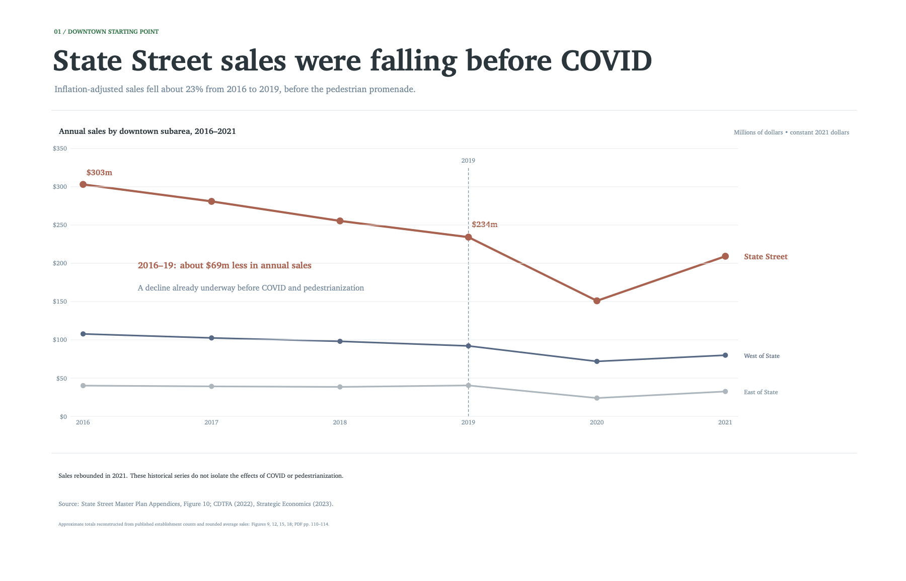
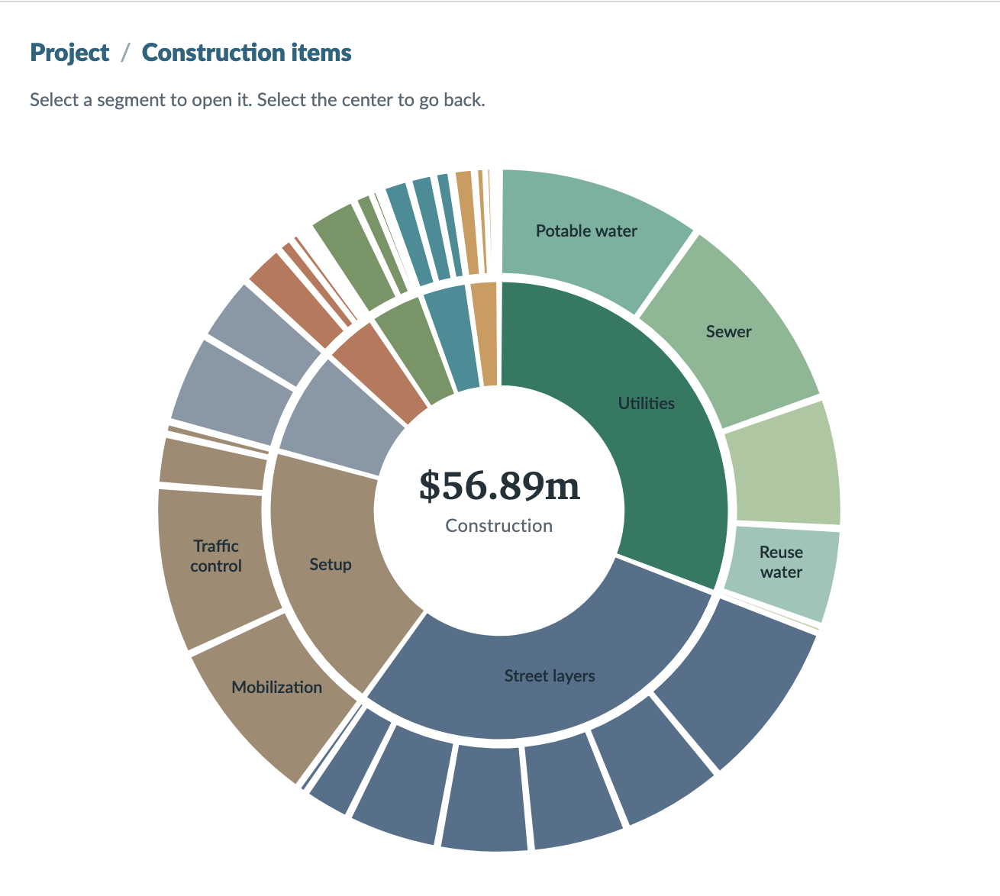
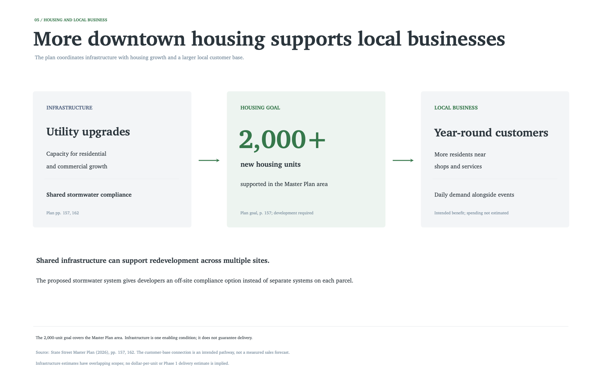
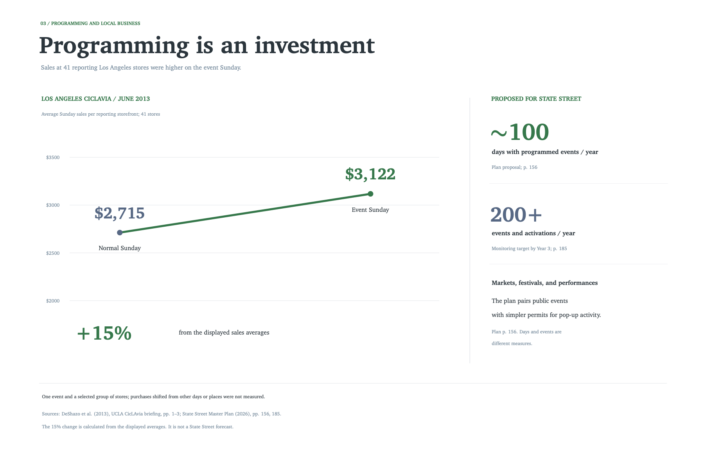
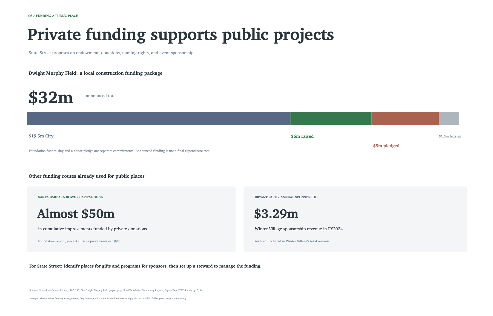
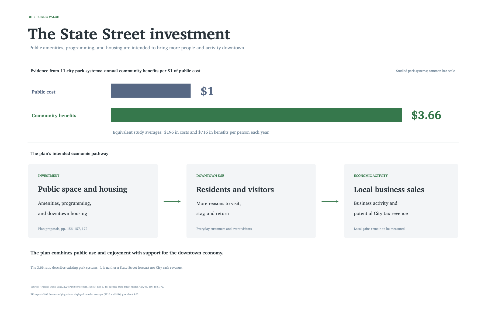

<!--
LOCAL SOURCE MAP
Read these raw files alongside this post for future revisions and visuals.
The new sales slide also has a portable source copy in _sources/ beside this file.
Comments are editorial notes; images are local copies.
Flow: existing economic decline -> infrastructure and development -> housing,
workers, businesses -> scope choices -> local giving -> civic ambition -> value.
Continuous prose, no headings or contents. Slide 7 / children's study omitted.

Research plan:
/Users/kian/ML/clojure/worktrees/state-street-evidence/SturdyStatsPlots/state_street_impact/research_visualization_plan.tex
Earlier narrative:
/Users/kian/ML/clojure/worktrees/state-street-evidence/SturdyStatsPlots/state_street_impact/narrative_outline.md
Writing references:
/Users/kian/ML/PersonalBlog/state_street.txt
/Users/kian/ML/PersonalBlog/state_street_draft.txt
/Users/kian/ML/PersonalBlog/state_street_draft_v2.txt
The first contains quotations/links; the others contain complete prose drafts.
Do not attribute quoted commenters' words to the author.
-->

State Street was losing ground before COVID and before the pedestrian promenade. The economic analysis in the master plan's appendices shows annual sales falling from roughly $303 million in 2016 to $234 million in 2019, measured in constant 2021 dollars. That is a decline of about 23 percent in three years. The number of businesses fell from 307 to 282 over the same period. [The City's figures](https://statestreet.santabarbaraca.gov/sites/default/files/2026-09/Adopted%20State%20Street%20Master%20Plan%20Appendices.pdf#page=110) document a downtown that already needed change.

<!--
New slide:
/Users/kian/ML/clojure/worktrees/state-street-evidence/SturdyStatsPlots/state_street_impact/v5_01_sales_trends.tex
Data, including reconstruction inputs:
/Users/kian/ML/clojure/worktrees/state-street-evidence/SturdyStatsPlots/state_street_impact/data/state_street_sales_2016_2021.csv
Method and limitations:
/Users/kian/ML/clojure/worktrees/state-street-evidence/SturdyStatsPlots/state_street_impact/evidence/v5_sales_trends.md
Raw appendix extraction:
/Users/kian/ML/clojure/docs/research/state-street-master-plan/appendices-pages.jsonl
Figure 10 has no point labels. Approximate totals use counts (Figure 9) times
rounded average sales (Figures 12, 15, 18), disclosed in the chart.
State: $303,075,005 -> $234,183,798, -22.73%.
Business-count alternative remains:
/Users/kian/ML/clojure/worktrees/state-street-evidence/SturdyStatsPlots/state_street_impact/v4_02_business_trends.tex
Local image: images/v4_02_business_trends.png.
-->

Sales fell further in 2020 and recovered substantially in 2021. These figures do not isolate the effects of the pandemic or closing the street to cars. They establish something more basic: State Street's difficulties began well before either. Any proposal for its future has to explain how it will support a stronger downtown.

The infrastructure beneath the street is part of that answer. The master plan describes underground utilities nearing the end of their service life and identifies reconstruction as an opportunity to replace them together. Water, sewer, storm drains, electrical, gas, and telecommunications systems all need to be considered while the street is open. Coordinating that work would avoid repeated excavation and disruption after new surfaces are installed. [Master plan, p. 163](https://statestreet.santabarbaraca.gov/sites/default/files/2026-09/Adopted%20State%20Street%20Master%20Plan.pdf#page=163).

Housing and commercial development also depend on infrastructure. The plan calls for utility upgrades that support anticipated growth and expand capacity proactively. It proposes a shared stormwater system that could allow redevelopment projects to meet requirements off-site. Developers could pay into that system instead of installing separate stormwater measures on each parcel. The plan identifies this as a way to help catalyze housing and give property owners a more flexible path to redevelopment. [Master plan, pp. 157 and 162](https://statestreet.santabarbaraca.gov/sites/default/files/2026-09/Adopted%20State%20Street%20Master%20Plan.pdf#page=162).

That is a practical connection between public investment and private development. Coordinated infrastructure can address work that would otherwise have to be resolved project by project. It belongs near the center of the discussion about bringing more people and businesses downtown.

<!--
Raw master-plan text:
/Users/kian/ML/clojure/docs/research/state-street-master-plan/master-plan.txt
p. 157: coordinated utility upgrades and proactive capacity.
p. 162: proposed shared stormwater compliance; fewer phases reduce mobilization.
p. 163: utilities nearing end of service life; avoid subsequent excavation.
No verified evidence here for "millions per project" or a categorical assertion
that all existing systems cannot support any growth. Shared system is proposed.
-->

The City's June 2026 estimate puts the project at $96.02 million. Of that, $56.89 million is itemized construction; the balance covers engineering, contingency, and right-of-way costs. I built a [cost explorer](https://sbpublic.com/state-street-costs/) from the City's estimates to show what those construction dollars would buy.

The construction includes $17.54 million in utility work, alongside excavation, paving, the street's underlying layers, and drainage. The visible improvements sit on top of systems that serve the rest of downtown.

To connect those costs to public goals, I grouped construction items by the purposes they may support. Approximately $28.97 million is linked to infrastructure that can support housing: about 51 percent of itemized construction, or 30 percent of the full project estimate. The highlighted parts of the chart show that work.

These are my analytical groupings of the City's cost lines. The infrastructure serves existing residents and businesses as well as future development, and some items support several goals. Housing, stormwater, utility, accessibility, and cycling totals therefore overlap. The housing-linked amount is a way to understand the work's purpose, rather than a separate budget reserved for new homes.

<!--
Editable HTML:
/Users/kian/ML/clojure/worktrees/state-street-site/public-comment/costs/template.html
Generated HTML and DATA:
/Users/kian/ML/clojure/worktrees/state-street-site/public-comment/costs/index.html
Goal mapping:
/Users/kian/ML/clojure/worktrees/state-street-site/public-comment/costs/build.py
Raw data:
/Users/kian/ML/clojure/worktrees/state-street-site/public-comment/costs/data/state_street_cost_items.csv
/Users/kian/ML/clojure/worktrees/state-street-site/public-comment/costs/data/state_street_cost_categories.csv
Scope/arithmetic:
/Users/kian/ML/clojure/worktrees/state-street-evidence/SturdyStatsPlots/state_street_impact/evidence/state_street_cost_breakdown.md
/Users/kian/ML/clojure/worktrees/state-street-evidence/SturdyStatsPlots/state_street_impact/evidence/state_street_cost_estimate_extraction.md
Construction $56,892,326; project $96,020,000.
Housing $28,968,856.50 = 50.92% construction / 30.17% project.
Utilities $17,537,937.50; stormwater $12,730,919; access $9,848,232;
cycling $7,947,152. Overlapping amounts; full linked-item cost is counted.
All utility subitems are tagged housing, not marginal costs caused by new homes.
Avoid "60%" or "vast majority of spending is housing."
Keep the $96.02m scope separate from the plan's $102m phasing figure.
All six screenshots remain available in images/:
construction-total.png, construction-housing.png, construction-stormwater.png,
construction-utilities.png, construction-accessibility.png, construction-cycling.png.
Only total/housing are displayed to keep the prose moving.
-->

The plan supports at least 2,000 new homes in the master plan area. Those homes could bring more daily activity to State Street and give local businesses a larger base of regular customers. Housing that people who work here can afford should be a priority as that development moves forward.

The relationship is straightforward. People who live nearby can shop, eat, meet friends, and use services downtown throughout the week. A walkable street makes those daily trips more appealing. Together, housing and public space can help businesses rely on a broader mix of residents and visitors.

Kevin Heim makes a related argument in [“A People-First State Street Is a Powerful Housing Tool”](https://www.independent.com/2026/08/31/a-people-first-state-street-is-a-powerful-housing-tool/): downtown housing and a street where people can live well without depending on a car belong in the same conversation. The plan's infrastructure proposals give that connection a concrete starting point. Delivering the homes will still require individual projects to be financed and built.

<!--
Housing slide:
/Users/kian/ML/clojure/worktrees/state-street-evidence/SturdyStatsPlots/state_street_impact/v4_05_housing.tex
Checks:
/Users/kian/ML/clojure/worktrees/state-street-evidence/SturdyStatsPlots/state_street_impact/evidence/v4_housing_funding.md
2,000+ is a plan goal/expectation, not units guaranteed by Phase 1.
Housing -> local workers -> business activity is an intended pathway.
No measured affordable rents, worker occupancy, jobs, or sales amounts.
Future graphic: separate homes built, who can afford them, and customer activity
once local evidence supports those intermediate steps.
Heim essay is an attributed argument, not a measured-effect estimate.
-->

Programming adds another reason to come downtown. The plan proposes approximately 100 days with programmed events each year, including markets, festivals, and community celebrations. Events can introduce people to a business and give them a reason to stay longer.

A study of Los Angeles's CicLAvia offers an example. Among 41 storefront businesses reporting sales for both an ordinary Sunday and the event Sunday, the displayed average rose from $2,715 to $3,122. That is about 15 percent higher, calculated from the report's dollar figures. The briefing's prose says 10 percent, an inconsistency worth retaining when citing the result. It is evidence from one event and a selected group of businesses, but it shows why programming deserves consideration alongside physical improvements. [UCLA CicLAvia briefing](https://www.its.ucla.edu/wp-content/uploads/sites/6/2013/11/UCLA_CicLAviaBriefing.pdf).

<!--
Programming slide:
/Users/kian/ML/clojure/worktrees/state-street-evidence/SturdyStatsPlots/state_street_impact/v4_03_programming_sales.tex
Evidence:
/Users/kian/ML/clojure/worktrees/state-street-evidence/SturdyStatsPlots/state_street_impact/evidence/v4_programming.md
407 / 2715 = 14.99%; brief says 10%. Retain visible discrepancy.
Selected reporting stores, self-reported sales, one event. Not causal local
sales or municipal receipts. Plan p. 156: ~100 days; p. 185: 200+ events by Year 3.
-->

There will be choices about how much to build and which materials and amenities to include. A smaller scope could reduce the initial bill. Those choices should also account for what would be lost, what would need to be built later, and what could attract support from outside the City budget.

The plan already identifies reasons to coordinate construction: fewer mobilizations, less repeated excavation, and less disruption to businesses. It also recognizes that higher-quality public spaces have value. A place people enjoy using can attract customers, recurring activity, and contributions toward its future.

Santa Barbara has a record of that kind of community investment. The Santa Barbara Bowl Foundation reports almost $50 million in improvements funded by private donations over time. The announced funding package for Dwight Murphy Field combines $19.5 million from the City, $6 million raised by the Gwendolyn Strong Foundation, a $5 million Ty Warner pledge, and $1.5 million in federal funding. Private funds raised and pledged account for $11 million of the $32 million package. [Bowl Foundation](https://sbbowl.com/es/impact/); [City project funding](https://sbparksandrec.santabarbaraca.gov/projects/dwight-murphy-field-renovation-project).

These projects show what is possible when people see lasting value in a shared place. Public investment can give the community something to invest in, too.

State Street's plan proposes a programming endowment, donations, naming rights, and sponsorship. Those sources will require fundraising and stewardship. Their potential is another reason to consider the quality of the place we are creating when evaluating its cost. [Master plan, pp. 167 and 180](https://statestreet.santabarbaraca.gov/sites/default/files/2026-09/Adopted%20State%20Street%20Master%20Plan.pdf#page=167).

<!--
Funding slide:
/Users/kian/ML/clojure/worktrees/state-street-evidence/SturdyStatsPlots/state_street_impact/v4_06_funding.tex
Evidence:
/Users/kian/ML/clojure/worktrees/state-street-evidence/SturdyStatsPlots/state_street_impact/evidence/donor_funding.md
/Users/kian/ML/clojure/worktrees/state-street-evidence/SturdyStatsPlots/state_street_impact/evidence/v4_housing_funding.md
Dwight Murphy: $6m raised + $5m pledged = $11m private, not $12m received.
Bowl nearly $50m is cumulative; no precise cutoff in cited statement.
No causal gift multiplier. Proposed "cut 10–20%" alternative is uncosted.
No verified comparison shows cuts necessarily increase total City expense.
Research a defined alternative before quantifying savings or forgone gifts.

Operating-finance follow-up, retained but not displayed:
/Users/kian/ML/clojure/worktrees/state-street-evidence/SturdyStatsPlots/state_street_impact/v4_04_programming_finance.tex
Local image: images/v4_04_programming_finance.png.
Winter Village FY2024 revenue $18,235,280; expenses $12,563,831.
Difference is before shared/other costs, not net profit or donations.
-->

That ambition has a place in Santa Barbara's history. The rebuilding after the 1925 earthquake helped establish the architecture that defines downtown today. The 1964 General Plan envisioned a pedestrian-oriented State Street. Decisions made decades ago continue to shape the city we live in. [Master plan history, pp. 30 and 36](https://statestreet.santabarbaraca.gov/sites/default/files/2026-09/Adopted%20State%20Street%20Master%20Plan.pdf#page=30).

In [“Build the Community ‘Living Room,’”](https://www.independent.com/2026/08/31/build-the-community-living-room/) Sullivan Israel places the current plan in that longer history of civic investment. I think that is the right scale of ambition. We should ask what State Street could contribute to the next century of Santa Barbara: who can live nearby, how businesses can thrive, and what kind of public life the street can support.

<!--
History: raw master-plan text, PDF pp. 30 and 36:
/Users/kian/ML/clojure/docs/research/state-street-master-plan/master-plan.txt
Use 1925 rebuilding, not "1940s transformation."
Israel and Heim essays published August 31, 2026. Supporting perspectives.
Do not repeat High Line returns, visitor counts, RHNA deadlines, or sales-tax
growth claims without primary checks. Plan targets are not financial forecasts.
-->

The return from a public space also includes the ordinary experience of using it. A place to walk, sit in the shade, meet friends, or spend time without having to make a purchase has value to the people who live here.

Trust for Public Land's 2026 report estimates that 11 large-city park systems provided $3.66 in annual community benefits for each dollar of annual public capital and operating spending. Its accounting includes recreation, health-care savings, stormwater savings, property-tax revenue, and outside contributions. The largest component is the value people receive from using the parks. [Trust for Public Land, Table 3](https://www.tpl.org/wp-content/uploads/2026/05/The-Undeniable-ROI-of-Community-Parks-and-Green-Spaces_TPL-ParkScore-Report-2026.pdf#page=15).

The estimate covers whole park systems and cannot be applied directly to State Street's construction cost. It does make an important part of the accounting visible: residents benefit from public places throughout their lives, including in ways that never appear as City revenue.

The master plan connects that public value to infrastructure, housing, and downtown business activity. Its implementation should be judged by whether it delivers those things. Homes need to be built, new infrastructure needs to serve them, and public spaces need to be maintained and used.

State Street's earlier decline gives us a reason to act. The construction estimate explains what the investment would involve. Santa Barbara's history and its record of community support give us reasons to think beyond the immediate bill. We have an opportunity to build a downtown that works better for the people who live here and for those who will make their lives here next.

<!--
Public-value slide:
/Users/kian/ML/clojure/worktrees/state-street-evidence/SturdyStatsPlots/state_street_impact/v4_01_public_value.tex
Detailed chart alternative:
/Users/kian/ML/clojure/worktrees/state-street-evidence/SturdyStatsPlots/state_street_impact/01_benefit_accounting.tex
Evidence:
/Users/kian/ML/clojure/worktrees/state-street-evidence/SturdyStatsPlots/state_street_impact/evidence/tpl_community_value.md
Annual modeled park-system benefits/public spending. Published ratio 3.66.
Consumer value $588 of $716/person; costs $196, all in 2025 dollars.
Never multiply a capital budget by the annual ratio or call all benefits City cash.
-->
