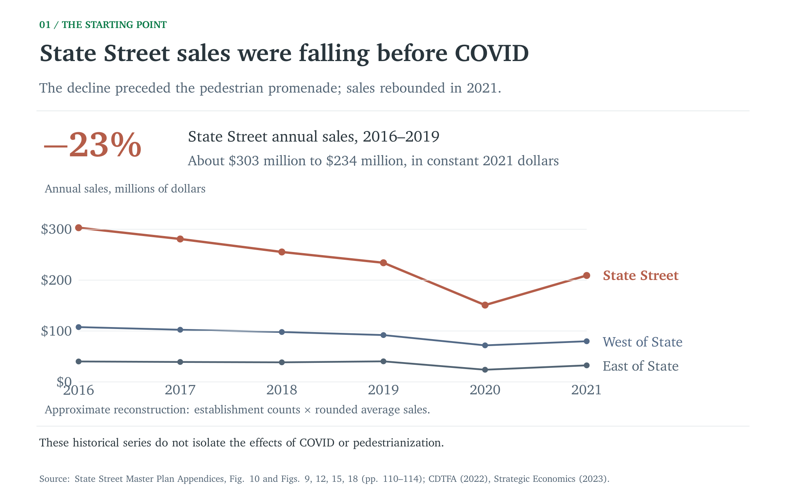
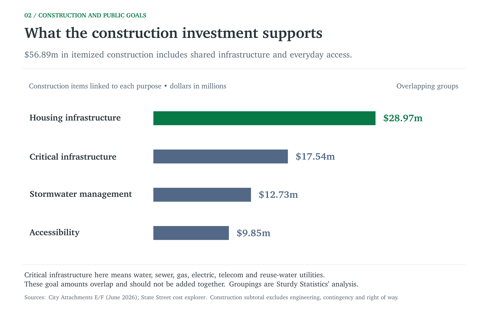
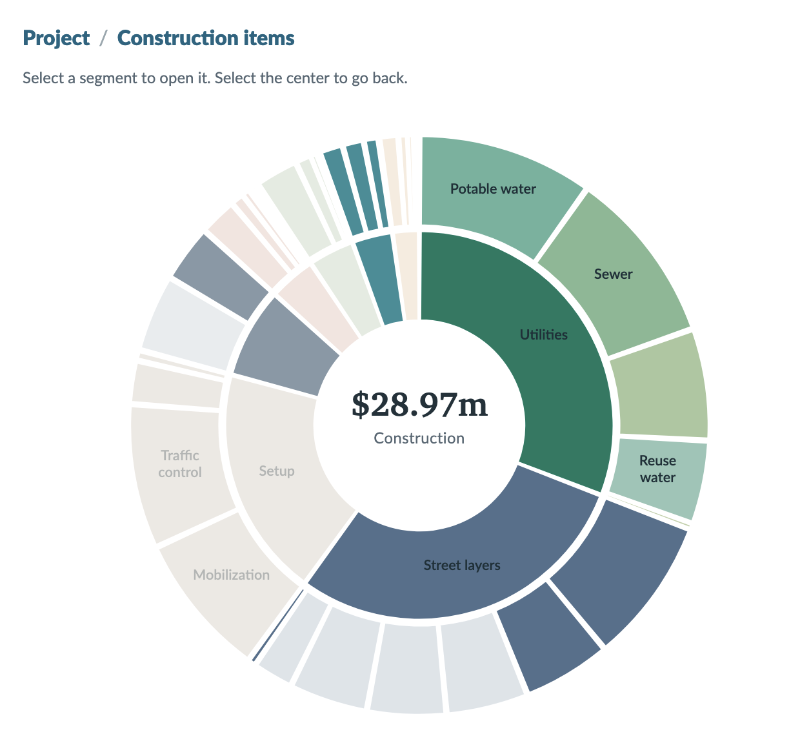
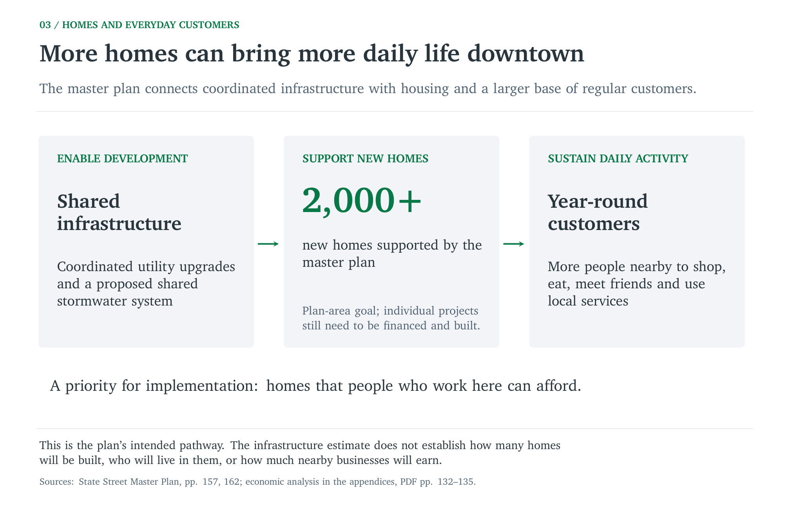
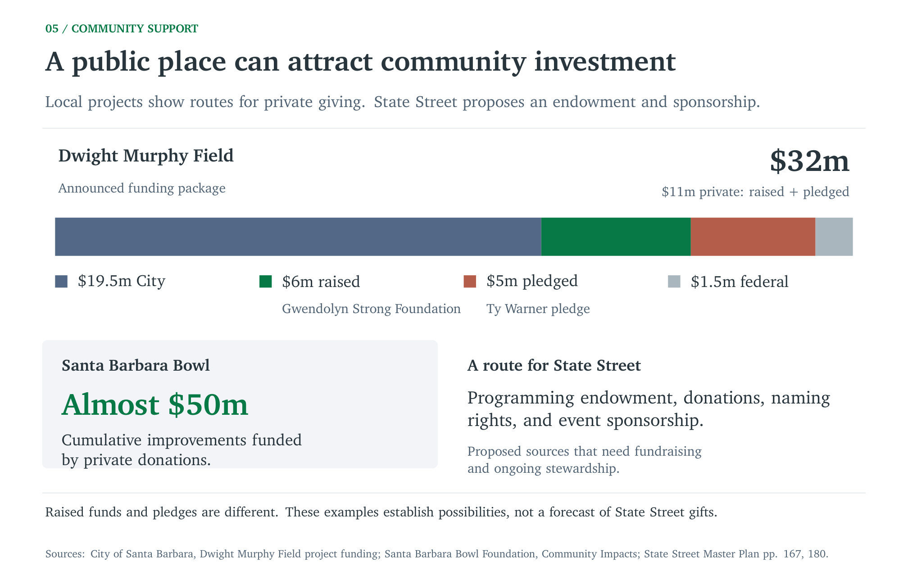

<!--
LOCAL SOURCE MAP
Read these raw files alongside this post for future revisions and visuals.
The new sales slide also has a portable source copy in _sources/ beside this file.
Comments are editorial notes; images are local copies.
Flow: existing economic decline -> infrastructure and development -> housing,
workers, businesses -> scope choices -> local giving -> civic ambition -> value.
Continuous prose, no headings or contents. Slide 7 / children's study omitted.

Research plan:
/Users/kian/ML/clojure/worktrees/state-street-evidence/SturdyStatsPlots/state_street_impact/research_visualization_plan.tex
Earlier narrative:
/Users/kian/ML/clojure/worktrees/state-street-evidence/SturdyStatsPlots/state_street_impact/narrative_outline.md
Writing references:
/Users/kian/ML/PersonalBlog/state_street.txt
/Users/kian/ML/PersonalBlog/state_street_draft.txt
/Users/kian/ML/PersonalBlog/state_street_draft_v2.txt
The first contains quotations/links; the others contain complete prose drafts.
Do not attribute quoted commenters' words to the author.
-->

The city is divided on State Street. The car-free vs pro-car debate and following referrendums has left the city fatigued. But everyone I have spoken to in the city is united on a few fronts.

1. They want to see business on State Street thrive.
2. They want to see new housing developments that supports an active workforce.
3. They want to see improvements in accessibility throughout the city.

These goals and the Master Plan are entirely decoupled from the question of cars on State Street.
In fact, the barrier to these goals has nothing to even do with State Street itself, but the ground beneath it.

State Street was losing ground before COVID and before the pedestrian promenade. The economic analysis in the master plan's appendices shows annual sales falling from roughly $303 million in 2016 to $234 million in 2019, measured in constant 2021 dollars. That is a decline of about 23 percent in three years. The number of businesses fell from 307 to 282 over the same period. [The City's figures](https://statestreet.santabarbaraca.gov/sites/default/files/2026-09/Adopted%20State%20Street%20Master%20Plan%20Appendices.pdf#page=110) document a downtown that already needed change.

<!--
New slide:
/Users/kian/ML/clojure/worktrees/state-street-evidence/SturdyStatsPlots/state_street_impact/v5_01_sales_trends.tex
Data, including reconstruction inputs:
/Users/kian/ML/clojure/worktrees/state-street-evidence/SturdyStatsPlots/state_street_impact/data/state_street_sales_2016_2021.csv
Method and limitations:
/Users/kian/ML/clojure/worktrees/state-street-evidence/SturdyStatsPlots/state_street_impact/evidence/v5_sales_trends.md
Raw appendix extraction:
/Users/kian/ML/clojure/docs/research/state-street-master-plan/appendices-pages.jsonl
Figure 10 has no point labels. Approximate totals use counts (Figure 9) times
rounded average sales (Figures 12, 15, 18), disclosed in the chart.
State: $303,075,005 -> $234,183,798, -22.73%.
Business-count alternative remains:
/Users/kian/ML/clojure/worktrees/state-street-evidence/SturdyStatsPlots/state_street_impact/v4_02_business_trends.tex
Local image: images/v4_02_business_trends.png.
-->

### Overdue Infrastructure Upgrades

State Street's infrastructure is nearing the end of its service life.
Water, sewer, storm drains, electrical, gas, and telecommunications systems are overdue for an updgrade and present a major barrier to any development efforts.
At the moment, any new development at State Street places a heavy burden on developers to build out this infrastructure themselves. This raises development costs, increases rent prices, impedes growth and limits housing. [Master plan, p. 163](https://statestreet.santabarbaraca.gov/sites/default/files/2026-09/Adopted%20State%20Street%20Master%20Plan.pdf#page=163).

The Master Plan's focus and the largest share of financial investment is directly focused on this core infrastructure. The plan calls for utility upgrades that support anticipated growth and expand capacity proactively. It proposes a shared stormwater system that could allow redevelopment projects to meet requirements off-site. Developers could pay into that system instead of installing separate stormwater measures on each parcel. The plan identifies this as a way to help catalyze housing and give property owners a more flexible path to redevelopment. [Master plan, pp. 157 and 162](https://statestreet.santabarbaraca.gov/sites/default/files/2026-09/Adopted%20State%20Street%20Master%20Plan.pdf#page=162).

<!--
Raw master-plan text:
/Users/kian/ML/clojure/docs/research/state-street-master-plan/master-plan.txt
p. 157: coordinated utility upgrades and proactive capacity.
p. 162: proposed shared stormwater compliance; fewer phases reduce mobilization.
p. 163: utilities nearing end of service life; avoid subsequent excavation.
No verified evidence here for "millions per project" or a categorical assertion
that all existing systems cannot support any growth. Shared system is proposed.
-->

The City's June 2026 estimate puts the project at $96.02 million. Of that, $56.89 million is itemized construction; the balance covers engineering, contingency, and right-of-way costs. I built a [cost explorer](https://sbpublic.com/state-street-costs/) from the City's estimates to show what those construction dollars would buy.

The construction includes $17.54 million in utility work, alongside excavation, paving, the street's underlying layers, and drainage. The visible improvements sit on top of systems that serve the rest of downtown.

To connect those costs to public goals, I grouped construction items by the purposes they may support. Approximately $28.97 million is linked to infrastructure that can support housing: about 51 percent of itemized construction, and likely will comprise a similar percentage of the full project estimate. The highlighted parts of the chart show that work.

<!--
Editable HTML:
/Users/kian/ML/clojure/worktrees/state-street-site/public-comment/costs/template.html
Generated HTML and DATA:
/Users/kian/ML/clojure/worktrees/state-street-site/public-comment/costs/index.html
Goal mapping:
/Users/kian/ML/clojure/worktrees/state-street-site/public-comment/costs/build.py
Raw data:
/Users/kian/ML/clojure/worktrees/state-street-site/public-comment/costs/data/state_street_cost_items.csv
/Users/kian/ML/clojure/worktrees/state-street-site/public-comment/costs/data/state_street_cost_categories.csv
Scope/arithmetic:
/Users/kian/ML/clojure/worktrees/state-street-evidence/SturdyStatsPlots/state_street_impact/evidence/state_street_cost_breakdown.md
/Users/kian/ML/clojure/worktrees/state-street-evidence/SturdyStatsPlots/state_street_impact/evidence/state_street_cost_estimate_extraction.md
Construction $56,892,326; project $96,020,000.
Housing $28,968,856.50 = 50.92% construction / 30.17% project.
Utilities $17,537,937.50; stormwater $12,730,919; access $9,848,232;
cycling $7,947,152. Overlapping amounts; full linked-item cost is counted.
All utility subitems are tagged housing, not marginal costs caused by new homes.
Avoid "60%" or "vast majority of spending is housing."
Keep the $96.02m scope separate from the plan's $102m phasing figure.
All six screenshots remain available in images/:
construction-total.png, construction-housing.png, construction-stormwater.png,
construction-utilities.png, construction-accessibility.png, construction-cycling.png.
Only total/housing are displayed to keep the prose moving.
-->

The plan supports at least 2,000 new homes downtown. Those homes will bring more daily activity to State Street and give local businesses a larger base of regular customers and employees. The planned dense housing will enable more people to live where they work and reduce the strain on our limitted freeway infrastructure. The benefits of this dense housing will propogate to less traffic and lower rents across the entire city of Santa Barbara. Kevin Heim speaks further on this in his op-ed [“A People-First State Street Is a Powerful Housing Tool”](https://www.independent.com/2026/08/31/a-people-first-state-street-is-a-powerful-housing-tool/).

<!--
Housing slide:
/Users/kian/ML/clojure/worktrees/state-street-evidence/SturdyStatsPlots/state_street_impact/v4_05_housing.tex
Checks:
/Users/kian/ML/clojure/worktrees/state-street-evidence/SturdyStatsPlots/state_street_impact/evidence/v4_housing_funding.md
2,000+ is a plan goal/expectation, not units guaranteed by Phase 1.
Housing -> local workers -> business activity is an intended pathway.
No measured affordable rents, worker occupancy, jobs, or sales amounts.
Future graphic: separate homes built, who can afford them, and customer activity
once local evidence supports those intermediate steps.
Heim essay is an attributed argument, not a measured-effect estimate.
-->

### When the City Invests in Santa Barbara, the People of Santa Barbara Invest Back into the City

A smaller scope focused exclusively on infrastructure upgrades may reduce the upfront price tag, but will likely cost the city more money in the short and long term.

Santa Barbara has a record of community investment. The Santa Barbara Bowl Foundation reports almost $50 million in improvements funded by private donations over time. The announced funding package for Dwight Murphy Field combines $19.5 million from the City, $6 million raised by the Gwendolyn Strong Foundation, a $5 million Ty Warner pledge, and $1.5 million in federal funding. Private funds raised and pledged account for $11 million of the $32 million package. [Bowl Foundation](https://sbbowl.com/es/impact/); [City project funding](https://sbparksandrec.santabarbaraca.gov/projects/dwight-murphy-field-renovation-project).

The plan estimates a major portion of the cost will come from members of the community excited to contribute to the next chapter of our beautiful city. [Master plan, pp. 167 and 180](https://statestreet.santabarbaraca.gov/sites/default/files/2026-09/Adopted%20State%20Street%20Master%20Plan.pdf#page=167).

State Street's master plan is investing in building a space for the community and bringing the community along for the entire process. The goal is not to check some boxes, but to engage and excite the community, a redesign of State Street akin to the 1920s conception of the American Riviera.

<!--
Funding slide:
/Users/kian/ML/clojure/worktrees/state-street-evidence/SturdyStatsPlots/state_street_impact/v4_06_funding.tex
Evidence:
/Users/kian/ML/clojure/worktrees/state-street-evidence/SturdyStatsPlots/state_street_impact/evidence/donor_funding.md
/Users/kian/ML/clojure/worktrees/state-street-evidence/SturdyStatsPlots/state_street_impact/evidence/v4_housing_funding.md
Dwight Murphy: $6m raised + $5m pledged = $11m private, not $12m received.
Bowl nearly $50m is cumulative; no precise cutoff in cited statement.
No causal gift multiplier. Proposed "cut 10–20%" alternative is uncosted.
No verified comparison shows cuts necessarily increase total City expense.
Research a defined alternative before quantifying savings or forgone gifts.

Operating-finance follow-up, retained but not displayed:
/Users/kian/ML/clojure/worktrees/state-street-evidence/SturdyStatsPlots/state_street_impact/v4_04_programming_finance.tex
Local image: images/v4_04_programming_finance.png.
Winter Village FY2024 revenue $18,235,280; expenses $12,563,831.
Difference is before shared/other costs, not net profit or donations.
-->

That ambition has a place in Santa Barbara's history. The rebuilding after the 1925 earthquake helped establish the architecture that defines downtown today. The 1964 General Plan envisioned a pedestrian-oriented State Street. Decisions made decades ago continue to shape the city we live in. [Master plan history, pp. 30 and 36](https://statestreet.santabarbaraca.gov/sites/default/files/2026-09/Adopted%20State%20Street%20Master%20Plan.pdf#page=30).

In [“Build the Community ‘Living Room,’”](https://www.independent.com/2026/08/31/build-the-community-living-room/) Sullivan Israel places the current plan in that longer history of civic investment. I think that is the right scale of ambition. We should ask what State Street could contribute to the next century of Santa Barbara: a place where people can live, work, enjoy, and come together as a community.

<!--
History: raw master-plan text, PDF pp. 30 and 36:
/Users/kian/ML/clojure/docs/research/state-street-master-plan/master-plan.txt
Use 1925 rebuilding, not "1940s transformation."
Israel and Heim essays published August 31, 2026. Supporting perspectives.
Do not repeat High Line returns, visitor counts, RHNA deadlines, or sales-tax
growth claims without primary checks. Plan targets are not financial forecasts.
-->

